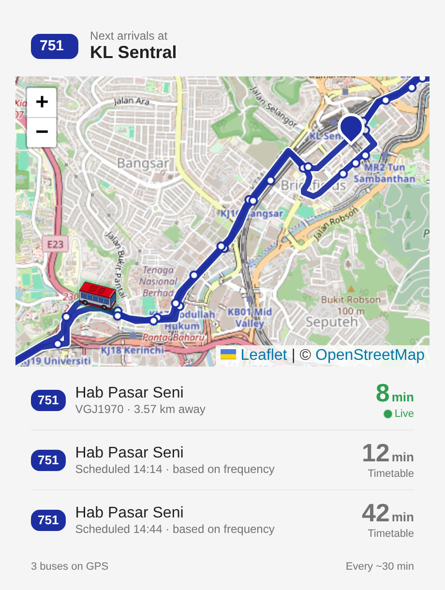

<p align="center">
  
</p>

<h1 align="center">Rapid Bus Tracker for Home Assistant</h1>

<p align="center">
  Live RapidKL and MRT feeder buses in Home Assistant: every bus on the map, an ETA to your stop,<br>
  and a built-in card that shows it all at a glance.
</p>

<p align="center">
  <a href="https://hacs.xyz"></a>
  <a href="https://github.com/zubir2k/homeassistant-rapidbus/releases"></a>
  
</p>

<p align="center">
  
</p>

## Features

- **Bus Tracker card, built in.** Live map with the route line, stop dots and 3D buses that turn to face where
  they're heading, plus your next arrivals. No other frontend add-ons needed.
- **Every bus is a device tracker.** Buses appear on the HA Map as they start running and disappear when they stop.
- **ETA to your stop.** Estimated from each bus's position along the actual route, not as the crow flies.
- **Timetable fallback.** When no live bus is coming, you still see the next scheduled one, clearly marked.
- **Follows your theme.** Light and dark map tiles, yellow chips for feeder routes, navy for RapidKL.
- **No API key.** Data comes from the official [data.gov.my GTFS API](https://developer.data.gov.my/realtime-api/gtfs-realtime).

Networks: RapidKL buses, MRT feeder buses, Rapid Kuantan and Rapid Penang.

## Installation

### HACS (recommended)
1. HACS → ⋮ → **Custom repositories** → add `https://github.com/zubir2k/homeassistant-rapidbus` as **Integration**.
2. Install **Rapid Bus Tracker** and restart Home Assistant.

### Manual
Copy `custom_components/prasarana_bus` into `/config/custom_components/` and restart.

## Setup

**Settings → Devices & services → Add integration → Rapid Bus Tracker**, then pick:

1. the network (e.g. MRT Feeder),
2. the route number (e.g. T807),
3. your stop (optional, but needed for ETAs). Stops are listed per direction, so pick the side of the road you
   board from.

Add the integration again for each route or stop you care about.

**Options:** update interval (default 30 s, minimum 15 s), how long a missing bus stays on the map (default
10 min), and the timetable fallback (default on).

## The Bus Tracker card

The card is served by the integration and loads automatically. Edit a dashboard → **Add card** → search
**Bus Tracker**, then choose your route's ETA sensor. Or in YAML:

```yaml
type: custom:rapidbus-card
entity: sensor.rapidbus_t807_lrt_lembah_subang_next_bus_eta
```

What you'll see:
- **Header**: route chip and your stop.
- **Map**: OpenStreetMap with the route, stops (from zoom 14), your stop pin and every live bus. It frames your stop
  and the next bus until you pan or zoom yourself. Tap a bus for its plate, speed, ETA and when it was last seen.
- **Arrivals**: live buses in green with a pulse, timetable times in grey with a clock. A short note explains when
  nothing live is on the way.

| Option | Default | Description |
|---|---|---|
| `entity` | *required* | Any of the route's sensors. A `…_next_bus_eta` sensor gives arrivals; `…_active_buses` gives just the map. |
| `rows` | `3` | Number of arrival rows. |
| `show_map` | `true` | Show the map. |
| `map_height` | `300` | Map height in pixels. |
| `zoom` | | Fixed zoom centred on your stop. Leave blank for automatic framing. |
| `bus_size` | `52` | Bus icon size in pixels. |
| `route_color` | navy (light blue in dark mode) | Route line colour, e.g. `"#e30613"`. |
| `show_stops` | `true` | Show stop dots. |
| `dark_tiles` | `auto` | `auto` follows your theme; `true` or `false` to force. |
| `title`, `stop_name` | | Override the header text. |

> After updating the integration, refresh your browser once (or clear the companion app's cache) so the new card
> version loads.

## Entities

Entity IDs start with `rapidbus_`, then the route, then your stop if you picked one, for example
`sensor.rapidbus_t807_lrt_lembah_subang_next_bus_eta`.

| Entity | Description |
|---|---|
| `sensor.…_next_bus_eta` | Minutes until the next bus reaches your stop. `eta_source` says whether it's `live` or `scheduled`. |
| `sensor.…_next_bus_status` | `approaching`, `at_stop`, `scheduled`, `none_heading_here`, `no_buses` or `no_service`. |
| `sensor.…_next_bus_distance` | Distance along the route to your stop, in km. |
| `sensor.…_next_scheduled_bus` | Next arrival from the timetable (timestamp), never live. |
| `sensor.…_active_buses` | Buses on the route reporting their location right now. |
| `device_tracker.…_<plate>` | One per live bus, with speed, bearing, destination and ETA. |
| `sensor.…_feed_updated` | Diagnostic: when the data was last published. |

The `next_bus_*` and `next_scheduled_bus` sensors are only created when you choose a stop.

<details>
<summary>All attributes</summary>

- **`next_bus_eta`**: `eta_source` (`live` / `scheduled`), `scheduled_time` and `frequency_based` (when scheduled),
  `headway_min`, `plate`, `heading_to`, `status`, `stop_id`, `stop_name`, `latitude` / `longitude` (the stop),
  `upcoming` (next 5 buses, each with `plate`, `eta_min`, `distance_km`, `heading_to`, `speed_kmh`, `bearing`,
  `latitude`, `longitude`, `last_seen`).
- **`next_bus_status`**: `plate`, `eta_min`, `distance_km` of the next bus.
- **`next_scheduled_bus`**: `upcoming` (next 5 times), `headway_min`.
- **`active_buses`**: `route`, `route_name`, `buses` (every live bus), `route_geojson`, `route_stops`. These last
  three are not recorded in history.
- **Bus trackers**: `route`, `plate`, `speed_kmh`, `bearing`, `heading_to`, `trip_id`, `last_seen`, plus `eta_min` /
  `distance_km` while heading to your stop.
</details>

## How the ETA works

The government feed publishes **bus positions only**, not official arrival times. So each bus is snapped onto its
route, the remaining road distance to your stop is measured, and that's divided by a speed blended from the
timetable average and the bus's current speed. Buses that have passed your stop or are going the other way are
ignored. The ETA is never 0 unless a bus is at the stop.

When no live bus is coming, the **timetable fallback** shows the next scheduled arrival instead:
- **MRT feeder** routes publish real departure times, so these are the actual timetable.
- **RapidKL** routes publish only a frequency ("every 15 min"), so treat these as a rough guide
  (`frequency_based: true`).

Turn the fallback off in Options if you'd rather see Unknown.

## Automation example

Leave-now alert on weekday evenings, only for a live bus. Set `below` to your walking time plus a few minutes.

```yaml
alias: Bus T807 - leave now
mode: single
triggers:
  - trigger: numeric_state
    entity_id: sensor.rapidbus_t807_lrt_lembah_subang_next_bus_eta
    below: 8
    for: "00:00:30"
conditions:
  - condition: time
    after: "17:00:00"
    before: "19:00:00"
    weekday: [mon, tue, wed, thu, fri]
  - condition: template
    value_template: "{{ state_attr(trigger.entity_id, 'eta_source') == 'live' }}"
actions:
  - action: notify.mobile_app_YOUR_PHONE
    data:
      title: Bus T807
      message: >
        {{ state_attr(trigger.entity_id, 'plate') }} is about
        {{ states(trigger.entity_id) | round(0) }} min away.
  - delay: "00:15:00"
```

To be told when a bus is at your stop, trigger on `sensor.…_next_bus_status` changing to `at_stop`.

## Services

| Service | Description |
|---|---|
| `prasarana_bus.refresh_static` | Re-download routes, stops and timetables now (also done automatically every 7 days). |

## Good to know

- Not every bus reports its location, so "0 buses" can mean no data rather than no service.
- `speed_kmh` assumes the feed reports km/h; this hasn't been verified yet.
- Map tiles load straight from OpenStreetMap in your browser. No key needed.

## Credits

- Bus data © Prasarana Malaysia Berhad via [data.gov.my](https://data.gov.my), licensed under [CC BY 4.0](https://creativecommons.org/licenses/by/4.0/). ETAs, statuses and timetable estimates are derived from that data by this integration and are not published by Prasarana.
- Maps by [Leaflet](https://leafletjs.com) (BSD-2, bundled) and © [OpenStreetMap](https://www.openstreetmap.org/copyright) contributors.
- Bus icons are original artwork, generated with `tools/bus3d.py`.

## Disclaimer

This is an independent, unofficial community project. It is not affiliated with, endorsed by or connected to Prasarana Malaysia Berhad, RapidKL or any Rapid operator. All product names, logos and brands belong to their respective owners; RapidKL and route names are used only to describe which buses the integration works with.

ETAs are estimates and can be wrong or missing, because not every bus reports its position. Don't rely on them for time-critical travel; check official channels for service updates.
